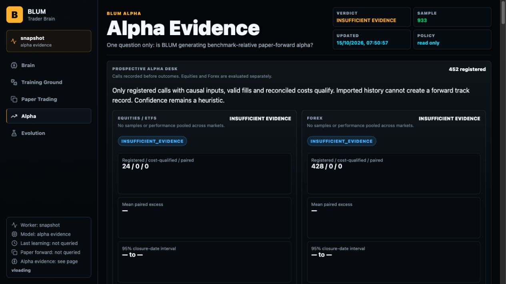
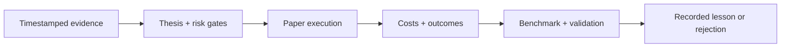

# BLUM

**An open-source financial research platform for tracing market ideas from evidence to paper outcomes.**

Investigate equities, ETFs and Forex. Inspect the reasoning, follow simulated execution, and see which conclusions survive costs, benchmarks and validation. BLUM brings that research loop into one public observatory, with the code and methodology open for inspection.

[](https://github.com/SignalLayerLabs/Blum/actions/workflows/ci.yml)
[](https://github.com/SignalLayerLabs/Blum/releases)
[](../LICENSE)

**[Open BLUM ↗](https://blum.signallayerlabs.workers.dev)** · [Read the docs](../docs/README.md) · [Run locally](#run-blum-locally) · [Contribute](../CONTRIBUTING.md)

## From market idea to accountable result

Financial research becomes more useful when you can reconstruct the decision. BLUM connects the original evidence, the thesis, the risk constraints and the eventual paper outcome. Missing inputs and failed checks stay visible, so an attractive result can be challenged rather than taken on trust.

| What you need to understand | What BLUM makes inspectable |
| --- | --- |
| **Why did this idea surface?** | Stored market evidence, decision inputs, reasoning and invalidation conditions |
| **Was the decision recorded in time?** | A prospective call registry with registration timestamps, frozen manifests and source fingerprints |
| **What happened after execution costs?** | Paper fills, costs, outcomes and the checks required for a qualified result |
| **Does the evidence support an edge?** | Separate equity/ETF and Forex evaluations, benchmark eligibility, sample counts and explicit blockers |
| **Did an experiment actually improve anything?** | ASCENT candidate artifacts, validation gates, lineage and rejection reasons |

Built for researchers investigating signals, developers building financial systems, and contributors who want reproducible evidence behind a claim.

## See it in the product

[](https://blum.signallayerlabs.workers.dev/alpha/)

*Actual Alpha Desk capture, 15 October 2026. Registrations are recorded decisions, not successful trades. Both markets were marked `INSUFFICIENT_EVIDENCE`; the image is a dated product view, not a live performance report.*

| Workspace | Use it to… |
| --- | --- |
| [**Brain**](https://blum.signallayerlabs.workers.dev/brain/) | Inspect decision quality, stored knowledge, uncertainty and runtime state |
| [**Training Ground**](https://blum.signallayerlabs.workers.dev/training-ground/) | Follow research priorities, validation progress and learning blockers |
| [**Paper Trading**](https://blum.signallayerlabs.workers.dev/paper-trading/) | Review simulated execution, history, costs, rejections and attribution |
| [**Alpha**](https://blum.signallayerlabs.workers.dev/alpha/) | Examine prospective calls, separate market evaluations and benchmark evidence |
| [**Evolution**](https://blum.signallayerlabs.workers.dev/evolution/) | Inspect bounded source experiments, evaluation gates and retained or rejected candidates |

The public observatory reads stored snapshots. Opening a page does not start research, train a model or execute a trade.

## A research process you can audit



**Record before evaluating.** The Alpha Desk registers new decisions in their source transactions. Frozen inputs, provider metadata and code fingerprints preserve a decision's lineage. Imported historical decisions cannot be relabeled as prospective calls. [Registration and qualification](../docs/research/alpha-desk.md).

**Keep different kinds of evidence separate.** Historical replay, walk-forward validation and paper-forward outcomes answer different questions. Equities/ETFs and Forex retain separate samples and verdicts. Unfilled orders, missing benchmarks and unreconciled costs cannot create qualified alpha. [Research methodology](../docs/research/methodology.md).

**Make improvement earn its place.** ASCENT generates bounded confidence-calibration candidates and evaluates them using chronological development folds and a frozen holdout. A restricted arithmetic interpreter limits candidate capabilities. Failed gates are recorded; candidates remain research artifacts and do not automatically change production code or models. [How ASCENT works](../docs/research/ascent.md).

## Where the evidence stands

BLUM 2.3 ships the prospective registry and its evaluation gates. **A validated prospective alpha track record has not been established.** Confidence remains a heuristic. The project makes no established outperformance or competitor-superiority claim.

The release data audit accepted **75,381 price-valid observations across 30 equity/ETF assets**, excluded five invalid bars and preserved eight missing-volume values as missing. These are replay inputs, not proof of returns. The accepted Forex history produces only one causal example, which is insufficient for validation. Existing reasoning archives remain quarantined for new training and promotion.

[Read the data decisions and limitations](../docs/research/data-quality.md) · [Inspect the audit ledgers](../docs/evidence/README.md) · [View release evidence](https://github.com/SignalLayerLabs/Blum/releases/tag/v2.3.0)

The supported boundary is financial research and paper trading. Paid HF training and automatic dataset publication remain disabled pending a validated replacement dataset. Embedded PostgreSQL uses periodic recovery snapshots; this is not a zero-loss durability guarantee. See [operations and recovery](../docs/operations/deployment.md).

## Run BLUM locally

The complete runtime uses Docker, Git and Git LFS:

```bash
git clone https://github.com/SignalLayerLabs/Blum.git
cd Blum
git lfs pull
docker build -t blum --build-arg BLUM_SOURCE_REVISION=$(git rev-parse HEAD) .
docker run --rm -p 7860:7860 blum
```

Open **[localhost:7860](http://localhost:7860)**. The image includes the web product, Python/CPU ML dependencies and embedded PostgreSQL, so the initial build can take several minutes. This disposable command is for exploration; follow the persistence guide before retaining research data.

[Setup and persistence](../docs/guides/getting-started.md) · [Development and checks](../docs/guides/development.md) · [Production deployment](../docs/operations/deployment.md)

## One project, clear responsibilities

**GitHub is BLUM's source of truth** for code, review, issues, documentation and releases. Verified source flows to the Hugging Face Python runtime and the Cloudflare public observatory. PostgreSQL holds financial evidence; the public gateway serves reviewed read-only APIs. Model outputs remain advisory, while deterministic engines own risk, execution simulation and accounting.

| Directory | Responsibility |
| --- | --- |
| [backend/](../backend/README.md) | Financial engine, APIs, workers, persistence, migrations and tests |
| [frontend/](../frontend/README.md) | Next.js research workspaces and view contracts |
| [cloudflare/](../cloudflare/README.md) | Public static assets, read-only gateway policy and edge tests |
| [model_release/](../model_release/README.md) | Advisory model tooling, sanitization, evaluation and release gates |
| [scripts/](../scripts/README.md) | Audits, research commands, deployment and recovery utilities |
| [docs/](../docs/README.md) | Guides, architecture, methodology, evidence and historical records |

[Architecture](../docs/architecture/README.md) · [Repository map](../docs/architecture/repository-map.md) · [Roadmap](../ROADMAP.md) · [Changelog](../CHANGELOG.md)

## Help build better financial research

Useful contributions improve source quality, decision traceability, evaluation, execution realism or usability. Start with a reproducible problem and the evidence needed to verify the improvement.

- [Contribution guide](../CONTRIBUTING.md) — development workflow and data requirements.
- [Report a bug](https://github.com/SignalLayerLabs/Blum/issues/new?template=bug_report.yml) or [propose an improvement](https://github.com/SignalLayerLabs/Blum/issues/new?template=feature_request.yml).
- [Support](../SUPPORT.md), [security reporting](../SECURITY.md) and [governance](../GOVERNANCE.md).

Application source is licensed under [Apache-2.0](../LICENSE). Dataset, market-provider, model and dependency terms are separate. Cite the exact revision used in research with [CITATION.cff](../CITATION.cff).
