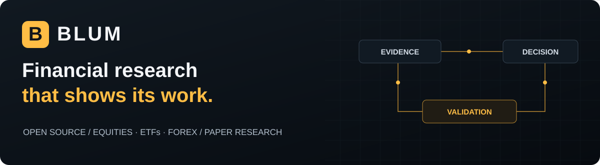

# BLUM Financial Research

Open-source financial research for tracing market ideas from evidence to paper outcomes. The supported markets are equities, ETFs and Forex, with separate evaluation for equities/ETFs and Forex.

**[Open the public observatory](https://blum.signallayerlabs.workers.dev)** · [Project presentation](.github/README.md) · [Documentation](docs/README.md) · [GitHub releases](https://github.com/SignalLayerLabs/Blum/releases)

## About this Space

This Hugging Face Docker Space runs BLUM's Python engine, scheduler, API and PostgreSQL evidence store. Cloudflare serves the public web product and its read-only gateway. GitHub is the canonical source for code, review, documentation and releases.

Explore [Brain](https://blum.signallayerlabs.workers.dev/brain/), [Training Ground](https://blum.signallayerlabs.workers.dev/training-ground/), [Paper Trading](https://blum.signallayerlabs.workers.dev/paper-trading/), [Alpha](https://blum.signallayerlabs.workers.dev/alpha/) and [Evolution](https://blum.signallayerlabs.workers.dev/evolution/). Page reads use stored snapshots and do not start research, train weights or execute trades.

## Research status

BLUM 2.3 provides prospective registration, paper accounting and bounded confidence-calibration experiments. A validated prospective alpha track record has not been established. Confidence remains a heuristic, and historical replay cannot become a forward track record through import.

Existing reasoning archives remain quarantined for new training/promotion. Paid HF training and automatic dataset publication remain disabled pending a validated replacement dataset. Read the [data policy](docs/research/data-quality.md), [Alpha Desk contract](docs/research/alpha-desk.md) and [ASCENT guide](docs/research/ascent.md) before interpreting results.

Trading ML retains separate incremental shadow learners for equity and Forex, with resumable unread-data queues and exactly-once sample identities. See the [learning-engine measurements](docs/research/learning-engine.md) for throughput, persistence requirements and the historical dataset experiment that did **not** beat its baseline.

The [outcome-driven trading curriculum](docs/research/trading-curriculum.md) adds random historical practice, frozen per-market checkpoints and prospective research-paper observations. Its calendar-checked benchmark shows four underperforming comparisons and two incomplete baseline paths; the selector remains experimental. The Research workspace exposes the measurements rather than treating memory growth as trading skill.

The curriculum source correction and its reproducible recovery evidence are documented in [Curriculum source recovery](docs/research/curriculum-source-recovery.md). Attempted blocks and useful outcomes are reported separately; the results do not establish alpha.

[LEAN-inspired valuation](docs/research/lean-inspired-valuation.md) adds open-position NAV, bar-close drawdown and a capital/time/cost-comparable modeled hold. In the recorded development windows, both USA policies underperform hold; FX full-path values remain withheld for invalid source bars. Measurement and learning counts are separate from proven trading skill.

## Run and operate

Use [getting started](docs/guides/getting-started.md) for the complete Docker runtime, [development](docs/guides/development.md) for component setup and checks, and [deployment and recovery](docs/operations/deployment.md) for trusted operations.

Startup may include database recovery. Check `/startup/status` for API/UI readiness and `/api/runtime/release` for the baked source revision and protected-content fingerprint. Embedded PostgreSQL recovery is periodic and does not guarantee zero-loss durability. Multiple replicas require an external database.

Application source is [Apache-2.0](LICENSE). Market-data, dataset, model and dependency terms are separate. [Contributing](CONTRIBUTING.md) · [Support](SUPPORT.md) · [Security](SECURITY.md).
