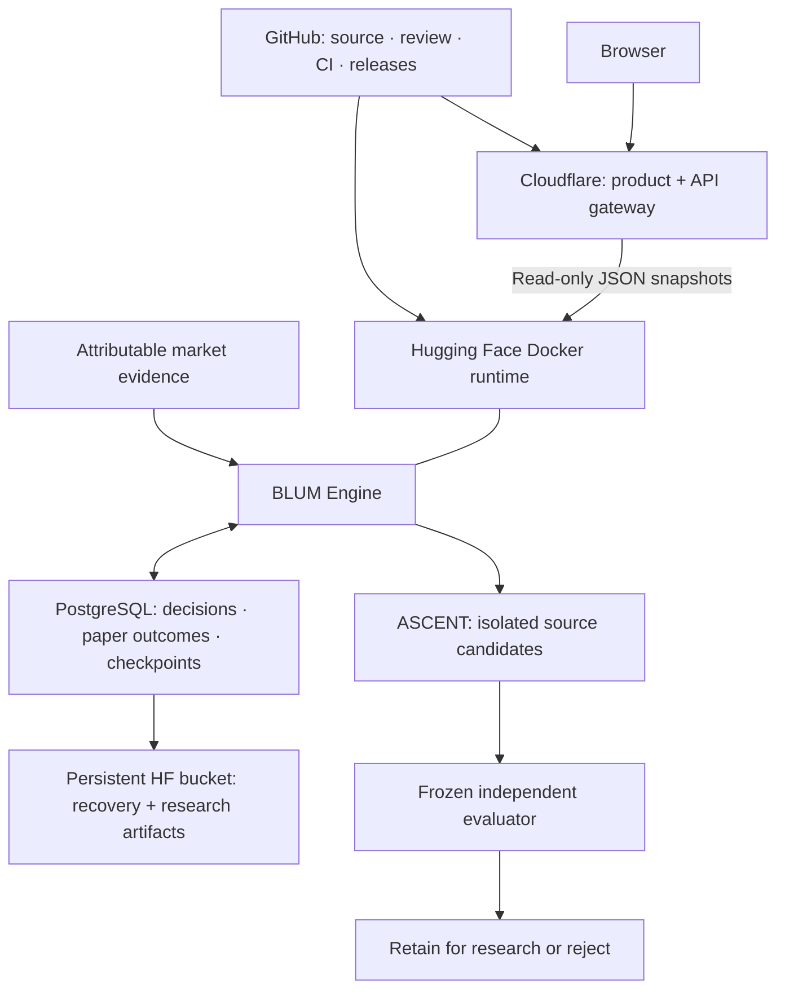

# BLUM

**An open-source financial research system that records what it knows, measures what happened, and rejects improvements the evidence cannot support.**

[](https://github.com/SignalLayerLabs/Blum/actions/workflows/ci.yml)
[](LICENSE)
[](https://github.com/SignalLayerLabs/Blum/releases)

[Open the observatory](https://blum.signallayerlabs.workers.dev) · [Releases](https://github.com/SignalLayerLabs/Blum/releases) · [Issues](https://github.com/SignalLayerLabs/Blum/issues) · [Deployment](docs/DEPLOYMENT.md) · [Data audit](docs/DATA_QUALITY.md)

GitHub is the canonical platform for BLUM's source, review, tests, releases, documentation and evidence reports. Cloudflare serves the public product and routes read-only API requests to the Hugging Face Docker runtime. The Engine and its PostgreSQL evidence store retain financial decision authority.

## The research loop

```text
Attributable evidence → timestamped thesis → deterministic risk gates
                    → paper execution → cost-aware outcome → validation
                    → recorded lesson or rejected experiment
```

BLUM researches equities, ETFs and Forex, stores reasoning and outcomes, and evaluates them against relevant baselines. Deterministic engines own risk, portfolio decisions, execution simulation and financial accounting. Optional model output remains advisory. Missing sources, weak samples and failed gates are reported explicitly.

The supported configuration is paper trading and research. There is no broker execution, guaranteed profit or independently established outperformance claim.

## Explore the product

| Surface | What it shows |
| --- | --- |
| [Brain](https://blum.signallayerlabs.workers.dev/brain/) | Decision quality, stored knowledge, uncertainty and runtime state |
| [Training Ground](https://blum.signallayerlabs.workers.dev/training-ground/) | Research priorities, validation progress, learning blockers and measured outcomes |
| [Paper Trading](https://blum.signallayerlabs.workers.dev/paper-trading/) | Simulated trades, execution history, costs, rejections and attribution |
| [Alpha](https://blum.signallayerlabs.workers.dev/alpha/) | Benchmark evidence, reliability, drawdown and performance limitations |
| [Evolution](https://blum.signallayerlabs.workers.dev/evolution/) | ASCENT generations, source hashes, evaluation gates, rejected candidates and resource budgets |

These pages read snapshots; opening a page does not launch training or research. The public gateway permits GET/HEAD. Administrative research and deployment use private credentials and trusted maintainer tools.

## What ships in 2.2

- **Bounded source evolution.** ASCENT generates four actual calibration source candidates per generation, tests them, freezes selection and evaluates the selected candidate against untouched evidence. Candidates can alter confidence calibration only.
- **Capability-free evaluation.** A restricted arithmetic interpreter permits finite constants, the scalar confidence input, arithmetic and min/max. Candidate code receives no filesystem, environment, network or host execution.
- **Independent validation.** Purged chronological development folds, a frozen holdout, baseline comparisons, asset/regime coverage, calibration regression checks and conservative time-block uncertainty gates determine retention.
- **Persistent experiments.** SQL checkpoints, source/evaluator/data hashes, consumed-holdout records and private artifacts preserve lineage and failures.
- **Data rejection at the boundary.** Invalid price candles and conflicting Forex records are excluded. Old external Forex projections and advice are rejected by the current policy.
- **Reproducible releases.** Locked web dependencies, backend/migration checks, gateway tests, reviewed data hashes and one-way GitHub deployment.

ASCENT retains research artifacts. It does not automatically merge code, replace a production champion, promote an HF model or place orders. Its budget is at most 2,000 observations, four candidates and 90 cooperative seconds per cycle, with at most eight generations per day. It uses no external inference or paid GPU job. Database operations are not forcibly preempted.

[Read ASCENT architecture and operation](docs/ASCENT.md).

## Evidence and data

Historical replay, walk-forward validation and paper-forward outcomes remain separate. Archived decisions do not become forward results when imported. Every new experiment must respect input availability, outcome maturity, costs, benchmark definitions, sample size and provenance.

| Input | Release audit decision |
| --- | --- |
| Equity/ETF cache | 75,381 price-valid observations across 30 assets; five invalid bars excluded; eight missing-volume values remain missing |
| Forex CSV | 71 non-ambiguous weekday snapshots, producing one causal example; insufficient for validation or promotion |
| Raw public reasoning dataset | 521 examples quarantined for new training/promotion |
| Persistent reasoning archives | All 95 versions quarantined; 21,424 occurrences represent 530 unique lineages |
| Community Memory dataset | No contribution records available |

Hash validity does not establish semantic validity. Reasoning archives have missing provenance and outcomes after declared cutoffs. A reproducible sanitized derivative of a previous dataset exists, but establishes no market edge. Database and recovery backups remain preserved; this source audit does not certify all their contents. [Read the exact decisions and limitations](docs/DATA_QUALITY.md).

## Architecture and deployment ownership



The Python/ML runtime remains on Hugging Face. Cloudflare does not own a second financial database. The gateway streams live JSON, disables financial-response caching, strips credentials/cookies, bounds upstream waits and rejects HTML masquerading as an API response. The web build is the existing full Next.js product.

The old HF → GitHub automatic import is removed. Deployments flow from verified GitHub `main` to HF and Cloudflare. HF publication is fast-forward-only; divergence stops publication for review. Neither workflow force-pushes canonical history.

## Run locally

Docker is the supported complete runtime:

```bash
git clone https://github.com/SignalLayerLabs/Blum.git
cd Blum
git lfs pull
docker build -t blum --build-arg BLUM_SOURCE_REVISION=$(git rev-parse HEAD) .
docker run --rm -p 7860:7860 blum
```

Open `http://localhost:7860`. The image includes CPU ML dependencies and may take several minutes to build. Without `DATABASE_URL`, startup manages embedded PostgreSQL. Production uses persistent `/data` recovery files or external PostgreSQL; multiple replicas require an external database.

Backend development with PostgreSQL already configured:

```bash
python3.12 -m venv .venv
. .venv/bin/activate
pip install torch==2.5.1 --index-url https://download.pytorch.org/whl/cpu
pip install -r requirements-dev.txt
PYTHONPATH=backend alembic -c backend/alembic.ini upgrade head
PYTHONPATH=backend uvicorn app.main:app --host 127.0.0.1 --port 7860
```

Web product and local gateway:

```bash
npm ci --prefix frontend --workspaces=false
npm --prefix frontend run build
npm ci --prefix cloudflare
npm --prefix cloudflare run types
npm --prefix cloudflare run preview
```

The gateway's default upstream is the public HF runtime. Change `BACKEND_ORIGIN` deliberately when using a different HTTPS backend. No secret belongs in `NEXT_PUBLIC_*`, browser code or Wrangler's public variables.

## Research operations

ASCENT is disabled by default in a fresh installation. The maintained deployment can enable its bounded scheduler explicitly:

```text
BLUM_ASCENT_ENABLED=true
BLUM_ASCENT_SCHEDULER_ENABLED=true
BLUM_ASCENT_INTERVAL_MINUTES=360
BLUM_ASCENT_ARTIFACT_ROOT=/data/ascent
BLUM_ASCENT_ADMIN_KEY=<private runtime secret>
```

Read state or run one cycle against a configured local database:

```bash
PYTHONPATH=backend python scripts/run_ascent.py --status
PYTHONPATH=backend python scripts/run_ascent.py --market equity --lane REPLAY_EVIDENCE
```

An unavailable revision, insufficient data, a consumed holdout or a failed gate blocks the relevant experiment. Rejected results are expected outcomes of a functioning validator. HF paid training and automatic dataset publication remain disabled pending a validated replacement dataset.

## Verify and release

```bash
PYTHONPATH=backend python -m pytest -q
PYTHONPATH=backend python scripts/audit_historical_sources.py --check
npm --prefix frontend test
npm --prefix frontend run build
npm --prefix cloudflare test
npm --prefix cloudflare run types
npm --prefix cloudflare run typecheck
```

[Verify BLUM](.github/workflows/ci.yml) runs these contracts on GitHub. [Deploy verified main](.github/workflows/deploy.yml) requires successful exact-revision checks, deploys HF, waits for readiness and the baked source revision, then publishes Cloudflare and smoke-tests all five surfaces.

Production requires `HF_TOKEN`, `CLOUDFLARE_API_TOKEN` and `CLOUDFLARE_ACCOUNT_ID` in GitHub's secret/variable stores. Provider, database and administrative secrets remain in HF's runtime secret store. [Read deployment, rollback and recovery procedures](docs/DEPLOYMENT.md).

## Repository guide

| Path | Responsibility |
| --- | --- |
| `backend/app/engine/` | Financial contracts and product read models |
| `backend/app/services/` | Evidence, risk, paper execution, learning and validation |
| `backend/app/services/ascent/` | Candidate language, datasets, frozen evaluation and checkpointed evolution |
| `backend/app/api/routers/` | Bounded APIs and legacy compatibility |
| `backend/alembic/` | Versioned SQL migrations |
| `frontend/` | Next.js product and view contracts |
| `cloudflare/` | Static-assets Worker, gateway policy and tests |
| `model_release/` | Advisory model release, sanitization and evaluation tools |
| `scripts/` | Trusted audits, research commands and deployment verification |
| `docs/evidence/` | Source audits and rejection ledgers |

[Architecture](docs/ARCHITECTURE.md) · [Methodology](docs/RESEARCH_METHODOLOGY.md) · [Engineering standards](ENGINEERING_STANDARDS.md) · [Changelog](CHANGELOG.md) · [Contributing](CONTRIBUTING.md) · [Security](SECURITY.md) · [Governance](GOVERNANCE.md)

Application source is licensed under [Apache-2.0](LICENSE). Market-provider, dataset and model terms are separate. BLUM Financial Lab contributors, 2026.
