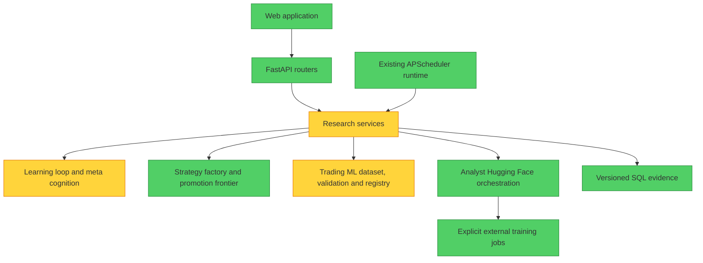

# BLUM ASCENT — first functional increment

## Architecture audit



Existing capability: autonomous ingestion and research scheduling, historical
learning and mistake memory, executable strategy variants, champion/challenger
registries, purged chronological validation, cost-aware replay, paper-forward
ledgers, and authenticated Hugging Face promotion/rollback. Existing learning
deliberately does not edit source code. ASCENT adds that missing bounded loop;
it does not replace those engines.

Audit findings (Brooks-Lint architecture mode):

- **Knowledge duplication — evaluation risk.** Several research services compute
  related metrics. Source: The Pragmatic Programmer, DRY. Consequence: another
  evaluator could disagree silently. Remedy: reuse trading ML folds and metrics.
- **Domain distortion — evidence classification.** Historical prediction rows
  are projected as PAPER_FORWARD by the existing trading ML feature adapter;
  replay features can fall back to outcome payloads. Source: Domain-Driven Design,
  bounded contexts. Consequence: source-evolution could learn from future fields
  or imply forward evidence. Remedy: ASCENT's adapter keeps historical predictions
  in REPLAY_EVIDENCE and uses confidence from the frozen decision only.
- **Cognitive overload — research services.** The existing lab and learning modules
  combine many responsibilities. Source: Code Complete, high-quality routines.
  Consequence: broad edits would increase regression risk. Remedy: add a focused
  package and thin API/scheduler integration. Team ownership is unknown, so the
  Conway's Law check is inconclusive.

## Design and implementation plan

Goal: a repeatable software evolution experiment in forecasting calibration.
The supplied master prompt authorizes implementation directly; this increment
is intentionally limited to a real, protected vertical slice.

1. Test and implement a bounded arithmetic source interpreter. Candidates are
   actual Python-shaped `calibrate(p)` source files, not executable host Python.
   The interpreter permits constants, `p`, arithmetic, and min/max only; rejects
   imports, attributes, calls to arbitrary functions, loops, excessive ASTs, and
   invalid probabilities. It cannot perform I/O or access host globals.
2. Test and implement immutable evidence snapshots, temporal holdout separation,
   existing purged walk-forward scoring, independent re-evaluation, conservative
   uncertainty and non-regression gates. Freeze candidate selection before
   opening holdout labels. Never mix evidence lanes. Never recycle holdouts.
3. Test and implement SQL checkpoints and isolated workspace artifacts. Generate
   shrinkage calibrators from the earliest purged training window; retain competing
   development results and generated regression cases, then validate one frozen
   candidate. Persist failures and rejections. Research retention grants no
   production decision authority. No automatic source/model promotion exists.
4. Test and integrate authenticated manual execution, disabled-by-default existing
   scheduler hooks, a CLI, and a read-only Evolution observatory. Expose real
   metrics, lineage, manifests, resource use and blockers. Reuse existing model
   and strategy champion projections; offer Level 2 status only.
5. Run security/integration tests, existing backend/frontend suites, TypeScript and
   production build; review the branch, commit, and open a PR against main.

Review focus: holdout overlap and changed evidence; source and artifact tampering;
timestamp ties/overlapping outcome horizons; concurrency/interrupted checkpoints;
missing confidence, provenance, costs, assets or regimes. Each must fail closed.

## Scope boundaries

This increment modifies only isolated forecasting calibration source. It does
not autonomously rewrite arbitrary application modules, fine-tune weights,
deploy, promote production champions, or execute trades. Retained artifacts are
research evidence requiring the established human review process. Software
improvement is measured separately from profitability. Financial outcome
metrics describe the identical stored decisions, since calibration does not
change selection or execution.

Only static historical forecasts without unverified learned-weight or memory
adjustments enter this increment. Historical decisions use the analysis date's
end of day, not the replay job creation time. Stored outcome frames are excluded
from inputs. A retained research Champion is usable only after its complete
outcome cutoff plus embargo; backfilled batches fall back to the static baseline.
Insufficient pages preserve bounded pending evidence and the source cursor.

## Operation

Apply the existing Alembic chain (`alembic upgrade head` from `backend/`) to reach
`0044_ascent_evolution`; the existing bootstrap also creates new model tables.
Defaults leave ASCENT and its scheduler off. No new runtime dependency is added.

```text
BLUM_ASCENT_ENABLED=true
BLUM_ASCENT_SCHEDULER_ENABLED=false
BLUM_ASCENT_ARTIFACT_ROOT=/data/ascent
BLUM_ASCENT_ADMIN_KEY=<administrative secret>
BLUM_ASCENT_MAX_ROWS=2000
BLUM_ASCENT_MAX_SECONDS=90
BLUM_ASCENT_INTERVAL_MINUTES=360
BLUM_SOURCE_REVISION=<40-character canonical source commit>
```

`GET /api/ascent/status` and `/evolution` read persisted evidence. Administrative
`POST /api/ascent/run` accepts only `market_family`, `evidence_lane`, and optional
`generation_uid`; send `X-BLUM-Admin-Key`. Arbitrary code, budget overrides,
promotion and deployment requests are unavailable. Local CLI:

```bash
python scripts/run_ascent.py --status
python scripts/run_ascent.py --market equity --lane REPLAY_EVIDENCE
python scripts/run_ascent.py --resume ascent-<existing-generation-id>
```

Only enable scheduled research explicitly after reviewing manual results. The
existing scheduler runs one bounded equity replay cycle per interval. Forex
research is manual in this slice and requires frozen confidence plus an explicit
net-cost contract. At most eight generations start per rolling day; each has at
most four candidates and 2,000 examples, with zero GPU or external inference use.
The time ceiling is cooperative: it does not interrupt a blocked database call.
Workers must share the artifact root for the filesystem lock. Unique SQL evidence
reservations also prevent two generations from consuming the same source IDs.
Stable economic decision identities prevent regenerated ledger IDs from
reintroducing previously consumed holdouts. Pending pages retain their provenance.

Source artifacts and generated regression cases remain in private isolated
directories. Snapshots, candidate code, metrics, failures, manifests, selection
and lineage remain in SQL. Resuming before holdout opening preserves the same
snapshot. An interrupted opened holdout is consumed and fails closed. Changed
source, evaluator, benchmark snapshot or code revision blocks continuation.

Level 2 continues to use `HF_TRAINING.md` and existing authenticated Hugging Face
snapshot/training/evaluation/promotion/rollback operations. ASCENT does not launch
those jobs. Canonical GitHub/Hugging Face synchronization is unchanged.

## Real-data reproducibility check

```bash
python scripts/verify_ascent_replay.py --output-dir .artifacts/my-ascent-check
```

This optional CPU-only check creates a **new isolated local SQLite database**.
It evaluates existing BLUM static forecasts on the packaged real OHLCV cache,
using the existing execution-cost model. It never opens the configured production
database. The cache has 75,386 observations; its SHA-256 is
`6ab7f3af855c859ac7b097f37f797961b160ad149ef15673ddd0aae0cc349bc2`.
No synthetic prices, news, fundamentals, sentiment or outcomes are generated.
Forecasts are derived from closed prices; unavailable news/fundamentals remain
unavailable. The verification's quality measure is observed OHLCV completeness,
distinct from the existing broader context-quality score. Same-period SPY returns
are expressed in each forecast's risk unit; they are not portfolio returns.

The run produced **550 eligible historical forecasts**, four competing sources,
427 development observations, 121 holdout observations, and two purged rows.
The selected candidate's holdout Brier loss was **0.245170**, versus **0.255506**
for frozen confidence and **0.246543** for training climatology. It was **rejected**:
insufficient slice coverage, fewer than 20 usable horizon-aware uncertainty blocks,
and material regressions in asset slices. The net trading outcomes were unchanged.
The recorded duration covers the ASCENT cycle, not upstream forecast preparation.
Repeating this check establishes reproducibility; it is not fresh promotion or
forward evidence. The report and isolated candidates remain in the output directory.

## Verification and remaining work

New security/integration coverage exercises arithmetic confinement, invalid
forecasts, temporal leakage, historical model/memory availability, purged folds,
timestamp ties, benchmark snapshot tampering, artifact hashes, holdout reuse,
checkpoint recovery, pagination, chronological Champion selection and API
authorization. Frontend tests preserve missing values and evidence distinctions.
The full Alembic upgrade and downgrade chain is tested on SQLite.

Full-suite baseline: 769 passed and five existing decision-council failures.
After implementation, the same five failures remain; no financial or security
gate was weakened. They are:

- `test_council_persists_analyst_debate_risk_and_portfolio_verdict`
- `test_council_disagreement_reduces_confidence`
- `test_mature_outcome_creates_reflection_used_by_later_same_ticker_decision`
- `test_duplicate_votes_from_one_engine_do_not_fake_independent_evidence`
- `test_new_engine_evidence_creates_a_new_council_version`

Their fixtures use an August 2026 decision clock with wall-clock-created votes
and reflections; the existing point-in-time gates exclude those later records.
Final backend result: **824 passed, five pre-existing failures**, including
**55 passing ASCENT tests**. Frontend result: **nine passed**. TypeScript checks,
the Next production build, and browser inspection succeeded.
The real rejection was visible in the observatory with no browser console errors.

This increment does not establish financial alpha, general reasoning superiority,
or smarter model weights. Source evolution currently covers arithmetic forecast
calibration only. There is no arbitrary-module rewriting, general code sandbox,
automatic canonical promotion, feature recombination, or autonomous redesign of
research priorities. Statistical intervals assume independent horizon-aware
blocks; residual dependence and historical selection can invalidate inference.
Execution costs are modeled, not proof of broker liquidity or fills. No
PostgreSQL deployment or forward-paper campaign was performed.

Next justified improvement: gather enough point-in-time forward forecasts across
assets and regimes, then test an additional bounded calibration family against
the frozen baseline and climatology using a fresh reserved holdout. Keep software,
model-weight and trading-profit claims separate.
