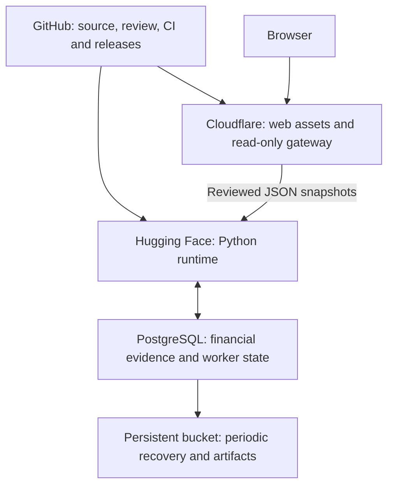
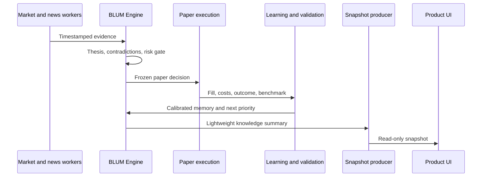

# BLUM architecture

[Documentation](../README.md) · [Repository map](repository-map.md) · [Deployment](../operations/deployment.md)

BLUM separates financial truth, model assistance and application delivery. This
boundary allows the Engine to continue learning when no browser is connected and
prevents UI code from becoming part of a financial decision.

## System boundaries

### BLUM Engine

The Engine is the source of truth for:

- point-in-time evidence and market memory;
- theses, competing views and confidence;
- risk gates, portfolio constraints and capital allocation;
- historical, walk-forward and paper-forward decisions;
- outcomes, benchmark comparison and learning events;
- research priorities and curated model datasets.

Engine modules may publish structured evidence or events. They must not import
frontend components or depend on a page request to run.

### BLUM Runtime

The Runtime owns FastAPI delivery, background scheduling, PostgreSQL lifecycle,
snapshot production, caching, health and the Next.js interface. Product GET
routes read stored evidence or snapshots and do not start learning or financial
recalculation.

### BLUM Finance model

The model boundary is an advisory reasoning assistant with gated export/training tooling. It
does not own market data, execution state or performance truth. Every model
response must be validated against current Engine evidence before it can affect a
decision. Existing reasoning archives are quarantined for new training/promotion;
paid training and automatic dataset publication remain disabled under the current
[data policy](../research/data-quality.md).

## Delivery and source ownership

GitHub is canonical. Publication flows one way from verified main to HF and
Cloudflare; HF source publication is fast-forward-only and stops on divergence.
Cloudflare owns neither a second financial database nor model/research execution.
The public gateway strips client credentials, rejects mutations and unreviewed
API paths, and disables financial-response caching.

## Knowledge flow

## Cooperative agents

Agent boundaries clarify evidence ownership without wrapping every service in an
empty abstraction. Market, News, Technical, Fundamental, Pattern, Decision,
Risk, Portfolio, Paper Trading, Learning, Research, Memory, Alpha, Validation and
Dataset agents publish structured outputs that can be tested independently.

Agents do not own UI and do not call one another's heavy computations directly.
Cross-module coordination uses persisted events, contracts and scheduled work.

## Runtime principles

- background-first computation;
- immutable historical evidence;
- bounded, resumable worker jobs;
- snapshot-first product reads;
- partial and stale-but-usable responses;
- explicit model and rule versions;
- no GET-side recalculation;
- no automatic modification of production source; ASCENT candidates stay isolated research artifacts;
- no fabricated data fallback.

## Persistence

PostgreSQL stores evidence, decisions, outcomes, learning history, worker state
and snapshots. Historical records are append-oriented. Derived snapshots are
replaceable read models and never the source of financial truth.

The maintained single-replica embedded database uses periodic object-storage
recovery files. This does not guarantee zero-loss restart durability. Multiple
replicas and stronger durability require a verified external database setup.
Read [recovery and rollback](../operations/deployment.md#recovery-and-rollback)
before any maintenance restart.

## Detailed references

- [Prospective registration and qualification](../research/alpha-desk.md)
- [Bounded ASCENT source experiments](../research/ascent.md)

The following records describe earlier versions and may contain superseded paths
or configuration:

- [Runtime architecture](../archive/runtime-architecture-v1.0.md)
- [v2 architecture split](../archive/architecture-split-v2.0.md)
- [Clean Core report](../archive/clean-core-v2.1.md)
- [Performance refactor report](../archive/performance-refactor-v1.0.md)
- [Project reference archive](../archive/project-reference.md)
