# BLUM — information-driven alpha engine

**Status:** architectural direction approved; this written specification awaits review. No implementation or alpha claim is implied. **Baseline:** main `a555f97b4b032b6e87b51bef25470d79b83f4df3`. **Date:** 20 October 2026, Europe/Rome.

## 1. Intended outcome

The user wants an engine that actively seeks relevant information worldwide, identifies opportunities, executes genuine paper trades, learns from outcomes and demonstrably beats the market. Faster charts, more archived text, growing memory counts, a larger language model, a high quoted win rate or more test cases do not satisfy that outcome.

BLUM will connect information acquisition, source-time evidence, numerical prediction, exact strategy execution, accounting and outcome learning into one operating cycle. Equities/ETFs and Forex retain separate evaluations. Success requires measured net outperformance on untouched chronological evaluation and subsequent prospective paper results. Until that evidence exists, the full objective remains open, even after a working engine ships.

“All information in the world” becomes broad, extensible access to reachable public information plus explicitly entitled feeds. Coverage, retrieval failures, source latency and unavailable/private information remain visible. Neither a provider list nor an unrestricted web-fetch tool can establish universal knowledge or an informational edge.

Paper-only operation and existing financial truth remain authoritative. Paid services, new persistent credentials and any real-money routing require their own authorization. The original explicit approval requirement for each merge/deploy remains in force.

## 2. Evidence motivating the redesign

Read-only code/runtime audits were captured against the baseline. The detailed records are retained in the task workspace under `work/alpha-engine-audit/`; this section states the reproducible causes rather than treating module names as functionality.

| Observed break | Source of evidence | Required change |
| --- | --- | --- |
| Selected Forex replay strategy loses its executable spec; live trading uses an aligned-trend rule with fixed five/ten pip geometry | `forex_trader.py:1085–1142`, `forex_contracts.py:175–187`, `forex_agents.py:51–74` | Bind decision, execution and outcome to the exact executable contract and fingerprint. |
| Real news affects daily signals, while intraday takes only bars/strategy/portfolio; FX macro expects metadata that providers do not populate | `news_ingestor.py`, `intraday_opportunity.py:58–100`, `forex_trader.py:968–1003` | A source-attributed event context must reach actual proposal generation. |
| Curriculum learning has its own simulator; daily paper stores memory adjustments that are not applied | `curriculum_worker.py`, `live_forward_paper_trading.py:242–254` | Reuse useful learned evidence through actual, versioned decision inputs; remove misleading “used” attribution. |
| Target distance less costs is called net expectancy | `intraday_opportunity.py:148–157`, `forex_agents.py:125–139` | Distinguish target opportunity from calibrated expected net outcome. |
| Current learned state enters historical analysis; retrospective examples can be labeled PAPER_FORWARD; repeated reliability updates lack source deduplication | `learning_loop.py`, `trading_ml/features.py:38–79`, `market_sniper.py:478–545,963–971` | Explicit evidence lanes, model cutoffs and exactly-once source identities. |
| Intraday decisions bypass Alpha Desk registration and lack its provenance schema | `intraday_paper_engine.py:514–688` | Register immutable decisions before submission, with execution-grade source times. |
| STOP_LIMIT can fill above its limit or below the observed bar range; lifecycle can consider post-expiry bars | `realistic_execution.py:110–153,223–242`, `paper_execution_lifecycle.py:143,199–215` | Repair execution semantics before relying on financial comparisons. |
| Discovery/research consumes execution budgets; resource deferrals are called completed; embedded recovery loses recent attempts | scheduler/runtime payloads; release16 persistence audit | Prioritize existing orders/positions, enforce work budgets, classify outcomes honestly, verify recovery. |

A pure local reproduction submitted a BUY STOP_LIMIT with stop100, limit100.005 and an entire later bar at109–111; the current engine reported FILLED at100.0125. It breached the limit and used an unobserved price. This is a correctness defect, not an experiment that demonstrates performance.

At the runtime sample, public news ingestion did work:69 sources succeeded,11 new articles and25 links were stored. USA stale-bar flags were collected before its regular session, so those flags alone do not establish a feed outage. FX rejected12 candidates for several conflated reasons. No sampled evidence demonstrates market outperformance.

## 3. Architecture and ownership

```mermaid
flowchart LR
  Sources[Public and entitled global sources] --> Acquire[Existing ingestion and provider adapters]
  Acquire --> Evidence[Immutable source events and feed capabilities]
  Evidence --> Context[As-of asset and currency context]
  Prices[Closed price bars and observed quotes] --> Context
  Context --> Strategies[Exact executable strategy contracts]
  Strategies --> Edge[Calibrated net-outcome advisor]
  Edge --> Decision[Frozen decision and Alpha registry]
  Decision --> Execution[Existing native paper execution]
  Execution --> Ledger[Orders fills positions costs and account NAV]
  Ledger --> Outcomes[Matured outcomes and matched controls]
  Outcomes --> Learner[Versioned training and validation]
  Learner --> Edge
  Outcomes --> EvidenceTest[Untouched and prospective benchmark evaluation]
```

The existing paper ledger and monetary engines remain the execution boundary. New information and numerical models produce or advise proposals; they do not write synthetic positions or directly invent fills. Existing historical simulators remain research tools and receive explicit research evidence types.

The public web app reads stored products. A page render cannot start research, train a model or send an order. Global retrieval runs in scheduled/event work with persistent cursors, per-provider budgets and observable source health.

## 4. Information acquisition and evidence contract

Each accepted item has a stable `evidence_id`, provider, canonical URL/accession, content hash, language, source capability, entity/currency/exposure links, `published_at`, `observed_at`, `available_at`, revision lineage and extraction version. Links retain confidence and a reason: exact issuer, currency, sector, commodity or ETF exposure. Sector news is not silently relabeled issuer news.

Live context requires evidence observed and available by the decision. Historical reconstruction additionally requires independently supported public availability and revision/vintage information; an original publication date does not automatically prove that every field was knowable then. Reconstructed history and prospective first-observed evidence stay different lanes. Missing dates cannot become “just published” because sentiment ran later.

Provider adapters return capabilities and status: available, empty, unavailable, quota-limited or entitlement-required. They retain last success, source timestamp, observed latency, Retry-After, cursor and coverage. Use per-host limiting, conditional requests/cache, bounded bytes/time and backoff. A403 or429 is a source failure, not neutral sentiment. No paywall, quota or access-control bypass is introduced.

Initial reachable inputs reuse successful RSS/news searches and official Fed/ECB releases, FRED current macro and existing price providers. Add issuer filing/current-event and multilingual discovery adapters where access succeeds. SEC403 and GDELT429 observed locally remain explicit until a deployed adapter succeeds. The [SEC API](https://www.sec.gov/search-filings/edgar-application-programming-interfaces) does not itself require an API key. Historical macro uses [ALFRED real-time periods](https://fred.stlouisfed.org/docs/api/fred/realtime_period.html); current revised FRED CSV is not a vintage-safe historical input.

Targeted retrieval expands a live thesis: issuer/related companies, macro currencies, filings and source citations. Untrusted documents supply evidence, never executable instructions. General URL retrieval validates public network destinations and redirects, enforces content/byte/deadline limits and records errors. A language model may extract a structured, cited hypothesis; it cannot declare its own probability of profitable trading as calibrated truth.

Provider credentials are optional adapters with explicit capability detection. The connected Alpaca tool in this chat is not an application credential and cannot be secretly transferred into Hugging Face. Consolidated equity quotes, FX bid/ask and consensus economic surprises require the relevant entitled source if the public feed cannot supply them. Such gaps are not filled with invented values.

## 5. Source context that changes decisions

Build one `OpportunityContext` per asset/pair and decision clock. It contains the exact eligible price/quote references, event IDs, coverage, freshness, causal surprise/novelty features and explicit missingness. Feature names have units and a versioned schema. Never sum raw interest-rate percentages, employment numbers and sentiment scores as comparable quantities.

USA context combines issuer/corporate events, sector/ETF exposure, market regime and price/volume conditions. FX context joins both currencies to primary central-bank/economic releases and risk context. A calendar state can be KNOWN_CLEAR, KNOWN_EVENT_WINDOW or UNKNOWN; UNKNOWN is not CLEAR. Consensus surprise remains missing unless a real consensus source exists. Actual releases and observed changes can still be modeled with their correct units.

Deduplicate syndicated stories into one event family. Novelty measures new evidence, not publisher count. Historical topic weights or label outcomes cannot be recomputed with future documents. Every feature snapshot records source IDs and maximum availability time.

The event-aware candidate path must actually consume these features. Tests hold the price path and model version fixed while changing eligible information; they must observe an attributable candidate rank, direction, risk size, veto or expected-outcome change. An identical price-only policy provides the paired control. Merely copying event IDs into a journal fails this requirement.

## 6. Strategy and expected-value contracts

Each proposal carries one canonical executable spec/fingerprint: entry conditions, stop/target or exit rules, holding horizon, direction, required data capabilities and information-feature schema. The exact spec used in validation must be the one evaluated live. The Forex evidence DTO must preserve it; a generic fixed rule cannot inherit another strategy's validation badge. Existing techniques and factory variants are usable only when their contracts execute and their source/time/cost assumptions match.

Reuse the existing scikit-learn numerical training primitives first. The outcome model estimates conditional probability and netR/return distribution from matured, source-deduplicated examples. Chronological calibration uses data not used to fit the model, with purge/embargo covering overlapping horizons. Record calibration quality, sample support and uncertainty by market/setup/regime. A bigger language model is not a prerequisite for this numerical path.

`target_distance_bps`, `estimated_round_trip_cost_bps`, `predicted_net_r`, `probability_positive_net_r` and uncertainty are separate fields. If training labels already contain costs, inference does not subtract them again. Expected value includes adverse outcomes and time exits; a target price minus fees is only an opportunity bound. Unsupported probabilities stay missing rather than defaulting to0.82 or treating a confidence score as a success rate.

Research exploration uses the existing reduced-risk paper lane with a predeclared allocation, the same fresh-data/execution/risk gates and truthful unvalidated status. It can collect prospective evidence before qualification; insufficient proof of alpha must not create a circular requirement that prevents every research trade. Conversely, negative economics, broken data or unavailable conversion cannot be overridden to meet a trade quota. Qualified decision authority remains evidence-gated.

Useful curriculum/replay outcomes can seed the numerical model with their research provenance and strategy identity. They do not become independent live observations. The live decision records which model/memory actually changed it. Matching memory is scoped to asset or explicitly justified pooled group, setup, horizon, regime and contract version. Unapplied adjustments are not called “used.”

## 7. Frozen decision, execution and accounting

Register each new decision before order submission, including research approvals, watchlists, abstentions and no-fills. Its immutable record contains source/context/model/spec hashes, numeric geometry, intended size, expected outcome, decision clock, expiry and evidence lane. Retries reuse its UID; old closed trades are not retroactively registered as prospective.

Intraday adapts its frozen payload to the existing Alpha registry, including actual provider and availability/acquisition fields. Both markets use shared canonical clocks for sessions, holidays/DST and bar completion. Bars acquired after a historical decision cannot leak into that decision; an order fill uses only genuinely later eligible observations. Closed-session monitoring is distinct from in-session stale-data failure.

Repair expiry before evaluating fill candidates, persist stop activation for STOP_LIMIT across observations, enforce the subsequent limit, retain partial remainders correctly and use adverse gap prices. When same-bar order of trigger/cross is unknowable, use the conservative documented outcome or withhold; do not invent a favorable intrabar path. Repeated lifecycle calls cannot duplicate fills, costs or capital.

Prioritize management of open positions and pending orders over new discovery. Every fill/mark/exit references the registered decision and the actual observation. Execution defects are fixed before monetary evaluation of new policies.

USA and FX account ledgers reconcile reserved cash/margin, partial fills, costs and realized/unrealized P/L. Forex pip value, pair quote units and account-currency conversion require actual timestamped conversion evidence. Review and reuse relevant existing cash-accounting WIP rather than silently merging or duplicating it. Legacy unverifiable monetary records remain outside qualified comparisons.

## 8. Feedback, historical practice and evidence integrity

Matured native outcomes create exactly one training example per source UID, with frozen decision features, decision/outcome clocks, actual net result, benchmark and evidence lane. No open or unknown result becomes a win/loss. Historical examples cannot receive PAPER_FORWARD merely because their database row was created today.

Random historical-date training replays the canonical strategies on source-valid archived context, with state/model cutoffs appropriate to each decision. Models learned today cannot be injected into a historical validation and called point-in-time. Reused development windows remain research monitoring; the confirmation partition stays unopened until the evaluation protocol permits its one final use.

Strategy reliability and memory updates deduplicate original outcomes. Keep tested policies, parameter trials, data versions and failed experiments in the trial ledger. The model can learn strategy selection, conditional effect and regime responses; it cannot improve a reported sample by recounting yesterday's trades.

## 9. Continuous operating contract and persistence

Order of service: open-position management → pending orders → session-appropriate fresh data → eligible information/candidate decisions → matured feedback → historical training/source discovery. Reserve execution capacity; a slow feed, universe scan, model fit or giant repair job cannot monopolize the process indefinitely. Bound network retries, DB work and model/research tasks, retain cursors and resume rather than restart full scans.

Classify completed productive work, no-signal, market-closed, data-blocked, deferred, timed-out and failed separately. The observed data-gap repair taking about64minutes despite nominal budgets must be replaced by enforceable chunks/deadlines. Read process/container resource measurements with declared scope; host-global memory pressure is not silently equated with the app's allowance.

Initial operating targets on the chosen, explicitly reported universe: open order/position work at least each60seconds during relevant sessions; eligible source context processed within two scheduled decision cadences; no unbounded discovery ahead of existing lanes. Measure provider publication latency separately from BLUM processing latency. Public bar data does not imply consolidated streaming quotes or high-frequency execution. If the workload exceeds the approved infrastructure, expose the measured capacity and prepare a concrete scaling/entitlement request; do not buy compute silently.

Strict persistence uses a correctly configured durable PostgreSQL service as the sole financial ledger. Existing bucket-backed embedded recovery has a nonzero recovery-point window and cannot claim zero-loss restart. For an embedded demo release, implement a protected quiesced checkpoint/verified fresh-backup preflight with a bounded lease and automatic recovery of scheduling on abort. A failed preflight blocks publication. This mitigates controlled releases; it does not claim to solve arbitrary host loss. The full strict-durability criterion remains open until an authorized durable database/recovery mechanism is configured and tested.

## 10. Financial evaluation and completion gates

Keep engineering proof and financial proof separate. A real paper fill proves machinery; it does not prove edge. Every experiment fixes the eligible universe, clocks, strategy/model versions, holding policy, costs, risk/exposure and benchmark before outcomes are inspected.

Evaluate price-only control, information-aware model, seeded established strategies, cash and passive same-market references on identical decisions/windows and account capital. Track complete NAV including open positions, turnover, drawdown, expectancy, hit rate, calibration and coverage. Report raw account return against passive market exposure as well as risk/exposure-matched excess; risk-adjusted superiority alone cannot be described as beating the market in absolute return. FX reports use explicit account-currency cash/exposure references, not an unrelated equity ETF.

Chronological research uses purged/embargoed folds and a final untouched confirmation window. Prospective paper trials freeze models/variants before collecting outcomes; adaptive versions receive new trial identities. Include realistic fee/slippage sensitivity, missing-data/execution failures, adverse regimes, trial count and dependence-aware uncertainty. Compare daily paired account return differences using session/block resampling; do not treat correlated expert counterfactuals as independent trades.

The initial promotion review requires at least100 closed prospective observations across at least20 distinct sessions for each separately claimed market, complete account/benchmark reconciliation, and a positive lower95% interval for predeclared net paired excess after trial-selection correction. These minimums permit a review, not an automatic “market beaten” conclusion. Dependence, unstable regimes or data defects can require more evidence. Promotion also needs acceptable risk/drawdown under the predeclared portfolio budget and cost stress. Failed evidence sends the hypothesis back to research without relabeling it a success.

The **full goal is complete only when** current code and deployed behavior prove broad operating information access; information/model contributions demonstrably influence decisions; recurring real paper execution and matured feedback work in both market families; source/model/accounting/persistence invariants hold; and untouched plus prospective financial evidence actually establishes the claimed net advantage. If a model fails, iterate the economic hypothesis/features/selection using the controlled process. Do not redefine completion as a dashboard, one feed, a faster worker, a positive training score or a new PR.

## 11. Delivery sequence and executable acceptance

The first integrated delivery must traverse the whole chain in both USA and FX research lanes: actual reachable source → immutable as-of context → canonical strategy/model-informed decision → native registered paper order → later real fill or justified no-fill → mark/exit/costed outcome → exactly-once feedback → paired control. Fix execution correctness and contract parity within that delivery. It is not satisfied by a scheduler-only or reporting-only patch.

Subsequent deliveries broaden sources/universe, improve calibrated models and historical coverage, close strict persistence and scale observed workload. Keep each release reviewable without claiming the full objective after its first slice. GitHub remains canonical; automatic production release still follows only an explicitly approved merge.

Required tests/experiments include: source429/403/missing dates and duplicate news; revision/as-of leakage; exact issuer/currency mapping; event-dependent decisions under identical prices; strategy-fingerprint parity; chronological model cutoff/calibration; expiry/stop-limit/gap/partial/idempotent execution; pre-order registry and immutable features; complete cost/FX/P&L reconciliation; outcome source deduplication; slow-source starvation; restart/deploy recovery; untouched experiment reproducibility; and observed deployed acquisition/decision/order/outcome progression. Synthetic fixtures test correctness and never become financial-performance evidence.

Deployment activation uses explicit feature versions and staged paper rollout. Preserve original journal IDs and model artifacts; retain earlier policy as the control. Rollback disables the new candidate producer while existing order/position management continues. Schema migrations and replay versions retain old evidence semantics. Secrets, restricted raw data and private runtime dumps stay outside Git.

## 12. Review decisions

The user has approved the architectural direction. This document now requests approval of the concrete architecture, operating/financial criteria and delivery boundary. After review, write the implementation plan with file ownership, dependencies, meaningful red/green tests, reproducible experiments and the chosen execution method. Product implementation starts after that required planning review. No new dependencies, paid jobs, accounts or live-money permissions are implicitly approved by this specification.
